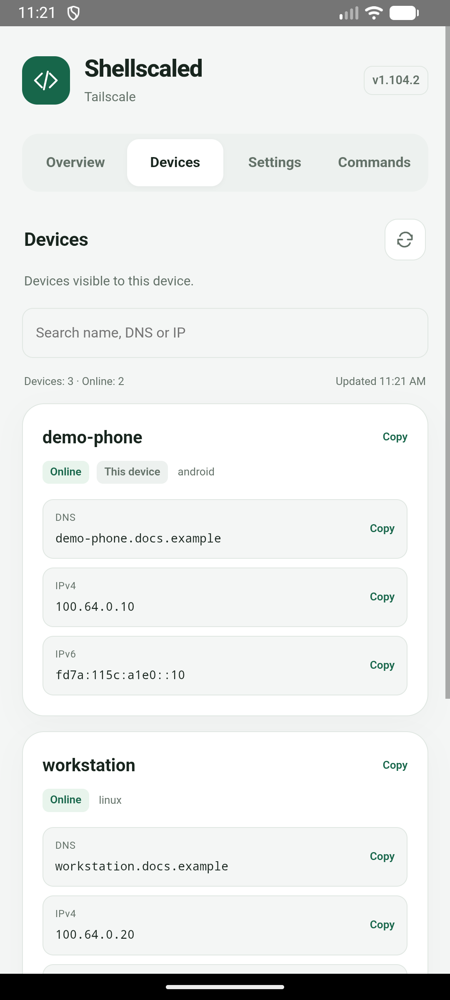
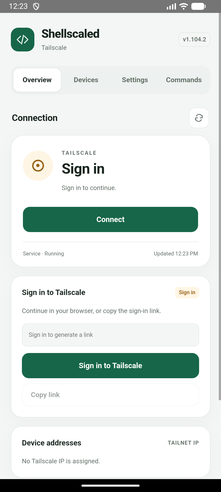

# Shellscaled

Run Tailscale natively on rooted Android without occupying Android’s VPN slot.

[简体中文](README.md) · **English**

[](https://github.com/KyuubiRan/Shellscaled/releases)

[Download the latest release](https://github.com/KyuubiRan/Shellscaled/releases) · Magisk / KernelSU · ARM64

> **Choose either Shellscaled or `magisk-tailscaled`.** Do not enable both. To switch, disable the old module and reboot before installing Shellscaled. Its sign-in state is not migrated automatically.

<p align="center">
  
  
  
</p>

<details>
<summary>First-time sign-in</summary>

<p align="center"></p>

</details>

## Features

- Connect or disconnect from your module manager and see connection status on the module card.
- KernelSU pages with address copying, a device list, preferences, Tailscale commands and links to the admin console and project home.
- Simplified Chinese, Traditional Chinese and English, following your system language or a manual selection.
- Offline installation, with your account and preferences preserved during updates.

## Installation

1. Download the **arm64** ZIP package from [Releases](https://github.com/KyuubiRan/Shellscaled/releases).
2. In **Magisk** or **KernelSU Manager**, choose **Install from storage** and select the ZIP.
3. **Reboot**, tap the module action button to connect, and follow the sign-in instructions. KernelSU users can also open the module page and choose **Sign in to Tailscale**.

<details>
<summary>Sign in from a terminal</summary>

   ```sh
   su -c 'tailscale login'
   ```

</details>

## Usage

After running `su` in `adb shell` or a terminal, use `tailscale` directly. Use `tailscaled` to start, stop, restart or check the service.

Use the module action button in your manager to connect or disconnect. KernelSU users can also open the settings page to manage subnet routes, incoming connections and LAN access when using an exit node. Switch changes take effect immediately.

**Receive files** defaults to `Download/Tailscale` in shared storage. Browse ordinary directories in primary shared storage, save your choice, and receive pending files. App-private directories are protected. See [Taildrop](docs/taildrop.md) for the receive workflow.

Tap a local address to copy it. The Devices page lets you search visible devices, check online status and copy names or addresses.

To update Tailscale on its own, choose Stable or Preview under **Binary updates** in Settings. Your account and preferences are retained. For module interface and feature updates, install the new module package and reboot. Uninstalling the module deletes its account and preferences.

## Credits and license

Shellscaled is a third-party project based on [Tailscale](https://github.com/tailscale/tailscale), with Android adaptations informed by [anasfanani/tailscale-android-cli](https://github.com/anasfanani/tailscale-android-cli), and originating from [anasfanani/magisk-tailscaled](https://github.com/anasfanani/magisk-tailscaled).

Distributed under the [BSD-3-Clause license](LICENSE), retaining upstream copyright and patent notices. Not affiliated with Tailscale Inc.
