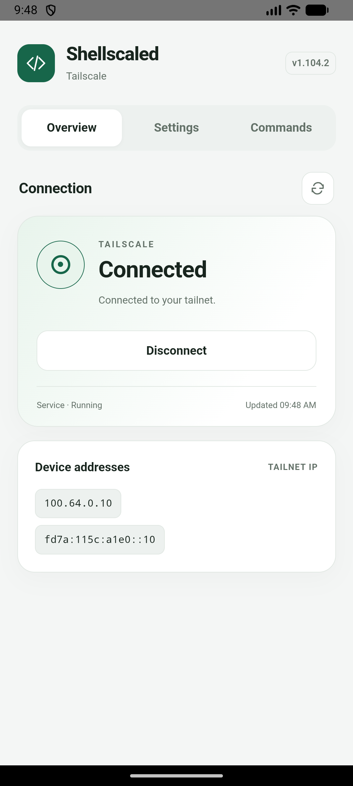
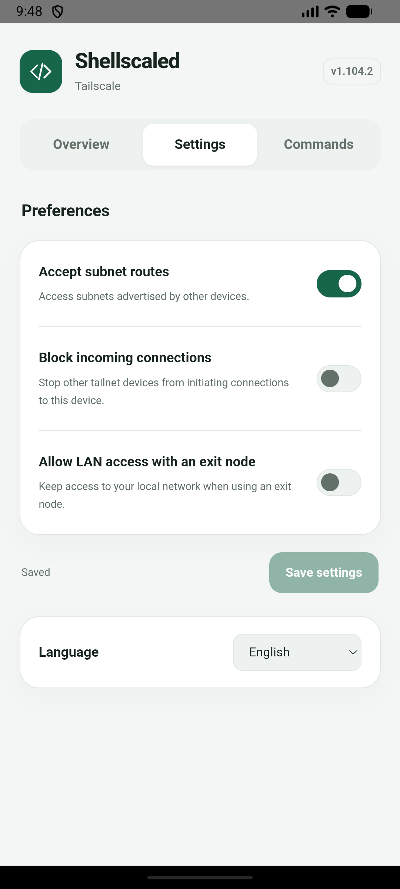
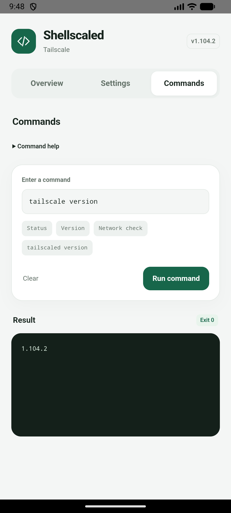

# Shellscaled

Run Tailscale natively on rooted Android without occupying Android’s VPN slot.

[简体中文](README.md) · **English**

[](https://github.com/KyuubiRan/Shellscaled/releases/latest)

[Download the latest release](https://github.com/KyuubiRan/Shellscaled/releases/latest) · Magisk / KernelSU · ARM64

> **Choose either Shellscaled or `magisk-tailscaled`.** Do not enable both. To switch, disable the old module and reboot before installing Shellscaled. Its sign-in state is not migrated automatically.

<p align="center">
  
  
  
</p>

## Features

- Connect or disconnect from your module manager and see connection status on the module card.
- A KernelSU settings page with device addresses, common preferences and Tailscale commands.
- Simplified Chinese, Traditional Chinese and English, following your system language or a manual selection.
- Offline installation, with your account and preferences preserved during updates.

## Installation

1. Download the **arm64** ZIP package from [Releases](https://github.com/KyuubiRan/Shellscaled/releases/latest).
2. In **Magisk** or **KernelSU Manager**, choose **Install from storage** and select the ZIP.
3. **Reboot**, tap the module action button to connect, and follow the sign-in instructions. KernelSU users can also connect from the settings page and copy the sign-in link.

<details>
<summary>Sign in from a terminal</summary>

   ```sh
   su -c '/data/adb/modules/shellscaled/bin/tailscale login'
   ```

</details>

## Usage

Use the module action button in your manager to connect or disconnect. KernelSU users can also open the settings page to manage subnet routes, incoming connections and LAN access when using an exit node.

To update, install the new module package and reboot. Your account and preferences are retained. Uninstalling the module deletes its account and preferences.

## Credits and license

Shellscaled is a third-party project based on [Tailscale](https://github.com/tailscale/tailscale), with Android adaptations informed by [anasfanani/tailscale-android-cli](https://github.com/anasfanani/tailscale-android-cli), and originating from [anasfanani/magisk-tailscaled](https://github.com/anasfanani/magisk-tailscaled).

Distributed under the [BSD-3-Clause license](LICENSE), retaining upstream copyright and patent notices. Not affiliated with Tailscale Inc.
