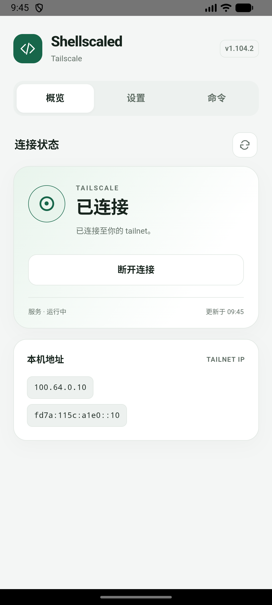
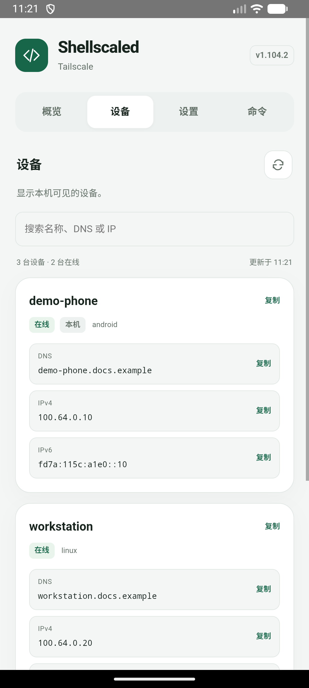
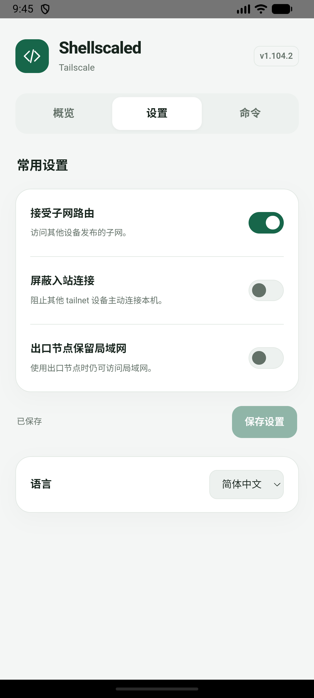
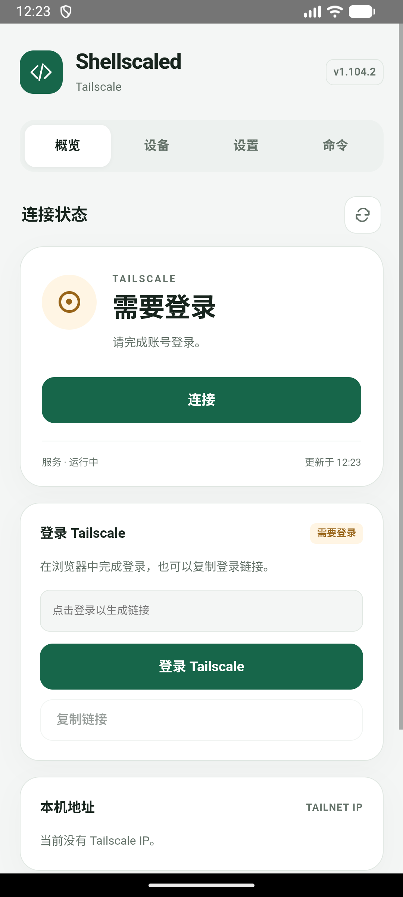

# Shellscaled

在已 Root 的 Android 上原生运行 Tailscale，不占用 Android VPN。

**简体中文** · [English](README.en.md)

[](https://github.com/KyuubiRan/Shellscaled/releases)

[下载最新版本](https://github.com/KyuubiRan/Shellscaled/releases) · Magisk / KernelSU · ARM64

> **冲突提示：请与 `magisk-tailscaled` 二选一。** 两者不能同时启用。切换前请停用旧模块并重启，再安装 Shellscaled；旧模块的登录状态不会自动迁移。

<p align="center">
  
  
  
</p>

<details>
<summary>首次登录</summary>

<p align="center"></p>

</details>

## 功能

- 在管理器中一键连接或断开，模块卡片显示连接状态。
- KernelSU 页面提供地址复制、设备列表、常用开关和 Tailscale 命令，并可前往控制台或项目主页。
- 支持简体中文、繁体中文和英文，可跟随系统语言或手动选择。
- 离线安装，更新保留账号与设置。

## 安装

1. 从 [Release](https://github.com/KyuubiRan/Shellscaled/releases) 下载 **arm64** ZIP 安装包。
2. 在 **Magisk** 或 **KernelSU** 管理器中选择「从本地安装」，安装该 ZIP。
3. **重启设备**，点击模块的运行按钮连接，首次使用时按提示登录。KernelSU 用户也可打开模块页面，点击「登录 Tailscale」完成登录。

<details>
<summary>通过终端登录</summary>

   ```sh
   su -c 'tailscale login'
   ```

</details>

## 使用

管理器中的模块按钮可切换连接状态。KernelSU 用户还可打开设置页面，管理子网路由、入站连接和出口节点的局域网访问；开关更改后立即生效。

「文件接收」默认保存到外部存储的 `Download/Tailscale`。可浏览主外部存储下的普通目录并保存选择，再点击接收文件；应用私有目录受到保护。接收流程见 [Taildrop 说明](docs/taildrop.md)。

在 `adb shell` 或终端执行 `su` 后，可直接使用 `tailscale`。`tailscaled` 可启动、停止、重启服务或查看状态。

点击本机地址即可复制；设备页可搜索本机可见的设备，查看在线状态并复制名称或地址。

只更新 Tailscale 时，可在设置中的「二进制更新」选择稳定版或预览版后检查并安装，账号与设置会保留。更新模块界面与功能时，安装新的模块包并重启即可。卸载模块会删除本模块的账号与设置。

## 来源与许可

Shellscaled 是第三方项目，基于 [Tailscale](https://github.com/tailscale/tailscale)，Android 移植参考 [anasfanani/tailscale-android-cli](https://github.com/anasfanani/tailscale-android-cli)，源自 [anasfanani/magisk-tailscaled](https://github.com/anasfanani/magisk-tailscaled)。

采用 [BSD-3-Clause 许可](LICENSE)，保留上游版权与专利声明。与 Tailscale Inc. 无隶属关系。
