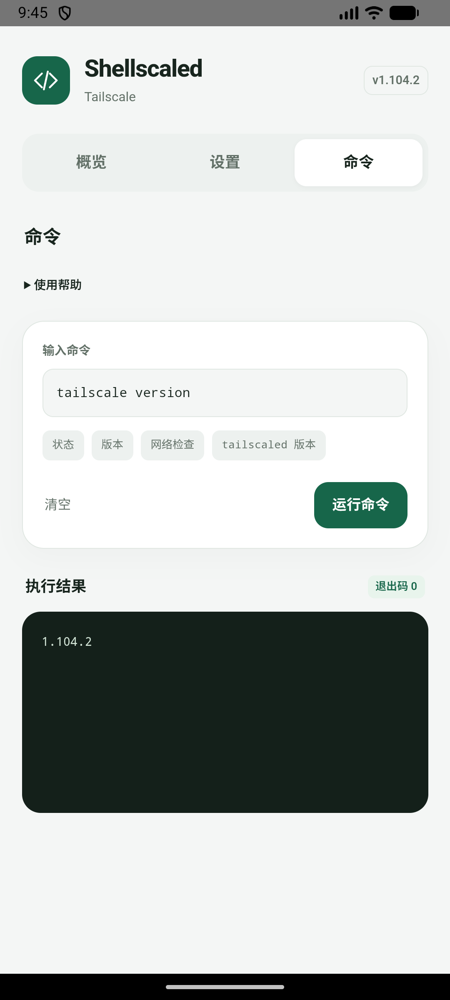

# Shellscaled

在已 Root 的 Android 上原生运行 Tailscale，不占用 Android VPN。

**简体中文** · [English](README.en.md)

[](https://github.com/KyuubiRan/Shellscaled/releases/latest)

[下载最新版本](https://github.com/KyuubiRan/Shellscaled/releases/latest) · Magisk / KernelSU · ARM64

> **冲突提示：请与 `magisk-tailscaled` 二选一。** 两者不能同时启用。切换前请停用旧模块并重启，再安装 Shellscaled；旧模块的登录状态不会自动迁移。

<p align="center">
  
  
  
</p>

## 功能

- 在管理器中一键连接或断开，模块卡片显示连接状态。
- KernelSU 设置页面提供本机地址、常用开关和 Tailscale 命令。
- 支持简体中文、繁体中文和英文，可跟随系统语言或手动选择。
- 离线安装，更新保留账号与设置。

## 安装

1. 从 [Release](https://github.com/KyuubiRan/Shellscaled/releases/latest) 下载 **arm64** ZIP 安装包。
2. 在 **Magisk** 或 **KernelSU** 管理器中选择「从本地安装」，安装该 ZIP。
3. **重启设备**，点击模块的运行按钮连接，首次使用时按提示登录。KernelSU 用户也可在设置页面点击连接并复制登录链接。

<details>
<summary>通过终端登录</summary>

   ```sh
   su -c '/data/adb/modules/shellscaled/bin/tailscale login'
   ```

</details>

## 使用

管理器中的模块按钮可切换连接状态。KernelSU 用户还可打开设置页面，管理子网路由、入站连接和出口节点的局域网访问。

更新时安装新的模块包并重启即可，账号与设置会保留。卸载模块会删除本模块的账号与设置。

## 来源与许可

Shellscaled 是第三方项目，基于 [Tailscale](https://github.com/tailscale/tailscale)，Android 移植参考 [anasfanani/tailscale-android-cli](https://github.com/anasfanani/tailscale-android-cli)，源自 [anasfanani/magisk-tailscaled](https://github.com/anasfanani/magisk-tailscaled)。

采用 [BSD-3-Clause 许可](LICENSE)，保留上游版权与专利声明。与 Tailscale Inc. 无隶属关系。
